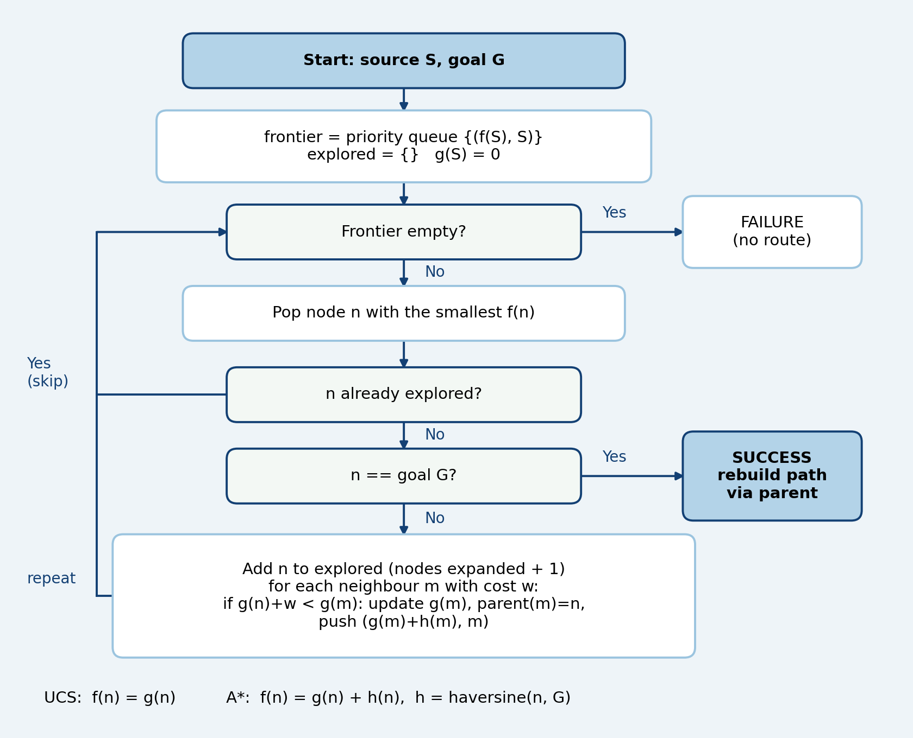
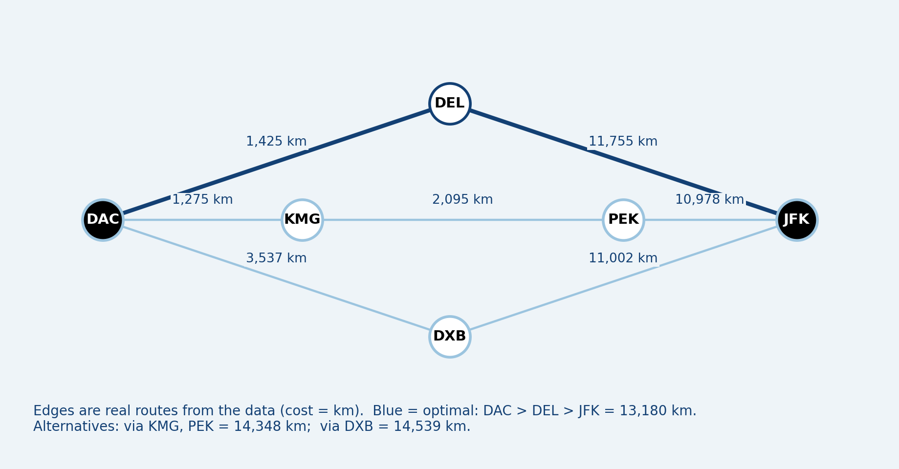
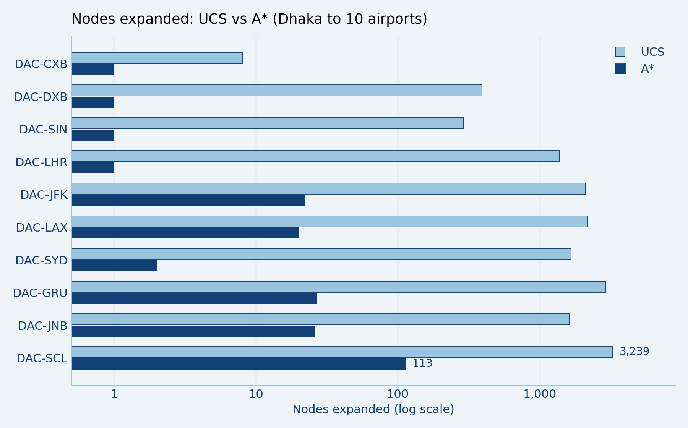
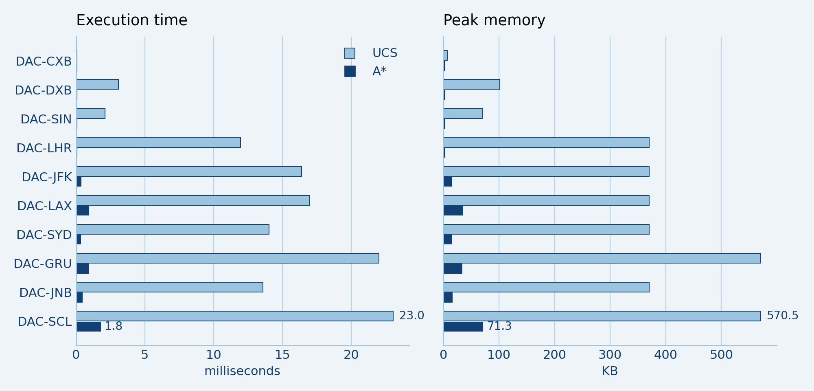
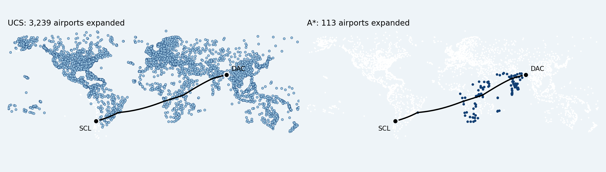
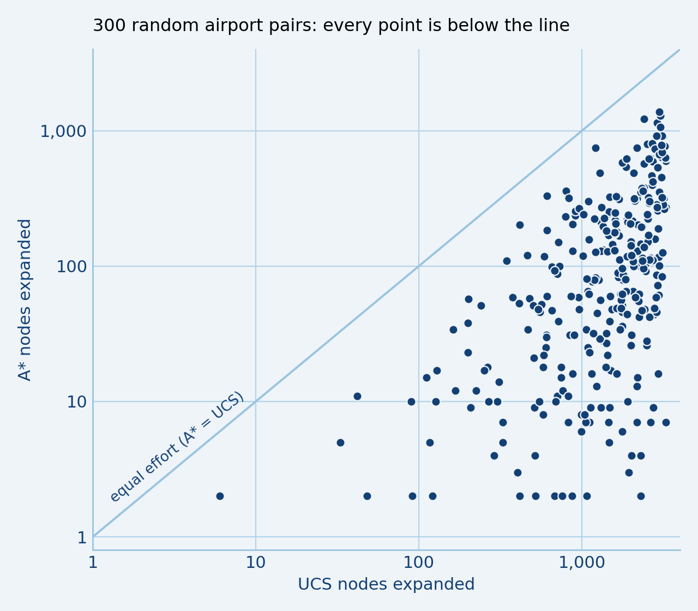
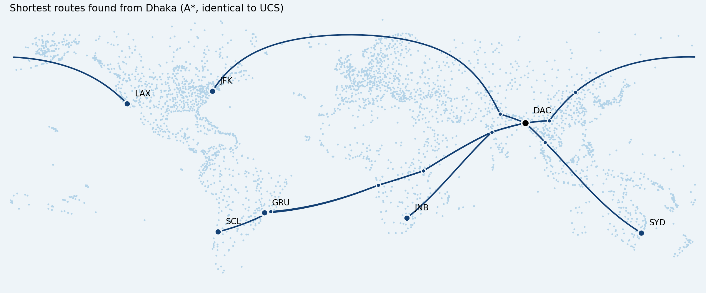

# Flight Route Search: UCS vs A* on the OpenFlights Network

[](https://colab.research.google.com/github/afia-tasnia/flight-route-search-ucs-astar/blob/main/Flight_Route_Search_en.ipynb)

**Shortest-Route Search on a Global Flight Network: Uniform Cost Search versus A\* with a Haversine Heuristic**

**Bangladesh University of Professionals (BUP)**
Department of Information & Communication Engineering
**Course:** Artificial Intelligence Laboratory (ICE-4108)

**Submitted by**

| Name | ID |
|---|---|
| Afia Tasnia | 23549009008 |
| Md. Rashedul Islam | 23549009100 |
| Muntasir Ahammed | 23549009042 |

**Instructors**

- Jasiya Fairiz Raisa, Lecturer, Department of Information & Communication Engineering, BUP
- Nazneen Akter, Assistant Professor, Department of Information & Communication Technology, BUP

## Overview

This project applies classical AI **search algorithms** to a real-world graph: the world airline network. Airports are nodes, flight routes are edges, and the edge cost is the great-circle (haversine) distance in km. The goal is to find the **shortest-distance route between two airports**.

| Algorithm | Type | Heuristic | Optimal | Complete |
|---|---|---|---|---|
| Uniform Cost Search (UCS) | Uninformed | None | Yes | Yes |
| A* Search | Informed | Haversine distance to goal | Yes (admissible, consistent) | Yes |

Both run from one shared function in the notebook (`best_first`): `use_heuristic=False` gives UCS (f = g) and `True` gives A* (f = g + h).

## Dataset

[OpenFlights Flight Route Database](https://www.kaggle.com/datasets/open-flights/flight-route-database) on Kaggle (OpenFlights data is under the Open Database License, ODbL).

- `routes.csv`: 67,663 route rows
- `airports-extended.csv`: 10,668 airports with latitude and longitude

The CSV files are **not included** in this repository. Download them from the link above.

### Cleaning and graph

| Step | Count |
|---|---|
| Raw routes | 67,663 |
| After dropping 423 rows with a missing airport ID | 67,240 |
| After removing 1 self-loop | 67,239 |
| Distinct directed airport pairs | 37,273 |
| Airports (nodes) | 3,330 |
| Undirected edges | 19,079 |
| Connected components | 7 (largest: 3,304 airports) |
| Average neighbours per airport | 11.46 |

The graph is treated as **undirected**, because 885 directed pairs have no reverse route in the data.

## Results

- **10 routes from Dhaka (DAC):** UCS and A* found the same optimal distance every time, while A* expanded **87.5% to 99.9% fewer nodes**. Hardest route, DAC to SCL: UCS expanded 3,239 nodes (8.4 ms) vs A* 113 nodes (0.7 ms).
- **300 random airport pairs (seed 42):** mean nodes expanded 1,629 (UCS) vs 177 (A*), i.e. **89.1% fewer**. A* was never worse than UCS.
- Mean path depth 5.16 hops, maximum 11.
- **Verification:** all results matched SciPy's Dijkstra on 110 pairs (10 named + 100 random), with 0 disagreements.

## Figures

**Algorithm flowchart** (shared by UCS and A*; only f(n) differs)



**Example state space:** DAC to JFK, optimal route DAC > DEL > JFK = 13,180 km



**Nodes expanded, 10 routes from Dhaka** (log scale)



**Execution time and peak memory**



**Search process, DAC to SCL:** UCS expands 3,239 airports, A* only 113



**300 random airport pairs:** every point is below the equal-effort line



**Shortest routes found from Dhaka**



## How to run

The notebook is written for Google Colab.

1. Download `routes.csv` and `airports-extended.csv` from Kaggle.
2. Upload both to your Google Drive in a folder named `flight_project` (path `MyDrive/flight_project/`).
3. Open `Flight_Route_Search_en.ipynb` in [Google Colab](https://colab.research.google.com/) (Upload tab, or open it from GitHub).
4. Run the cells top to bottom (Shift + Enter). Colab asks permission to access Drive on the first cell.

To run elsewhere, replace the Drive cell with a local path and set `DATA_DIR` to your data folder.

**Try your own route** (Step 6 of the notebook):

```python
find_route("DAC", "SCL")   # use any two IATA airport codes
```

**Notebook outline:** 1) connect Drive, 2) haversine distance, 3) loading and cleaning, 4) graph construction, 5) UCS and A*, 6) run on any two airports, 7) experiments, 8) charts and maps.

**Repository contents:** `Flight_Route_Search_en.ipynb` (code), `figures/` (the 7 charts above, as saved by the notebook).

**Outputs the notebook creates:** `results_named_pairs.csv`, `results_random_pairs.csv`, `results.json`, and the figures `fig_nodes_expanded.png`, `fig_time_memory.png`, `fig_random_scatter.png`, `fig_search_process.png`, `fig_routes_map.png`, `fig_flowchart.png`, `fig_state_space.png`.

## Requirements

Python 3.9+ with `pandas`, `numpy`, `matplotlib`, `scipy` (SciPy is used only to verify results). On Colab these are already installed.

## Limitations and future work

- The graph is undirected, but real routes can be one-way.
- Cost is distance only (no price, flight time or layovers).
- Possible extensions: BFS (fewest stops), Greedy Best-First, Iterative Deepening.

## Acknowledgements

Data: [OpenFlights](https://openflights.org/data.html).
